<div align="center">

<picture>
  <source media="(prefers-color-scheme: dark)" srcset=".github/assets/banner-dark.svg">
  
</picture>

**Optional native toast for PAM Native.**<br>
Moved out of the PAM Native core in 1.46.6: install it only when your app shows toasts. Without this plugin the host ships no toast renderer.

[](https://packagist.org/packages/pushinbr/pam-native-toast)
[](https://github.com/push-in/pam-native-toast/releases/latest)

[](LICENSE)

[Install](#install) · [Quick example](#quick-example) · [Platforms](#platform-support) · [Migration](#migration) · [Docs](#docs) · [Issues](https://github.com/push-in/pam-native-toast/issues)

</div>

<a id="install"></a>
## <picture></picture> Install

Inside a PAM Native project (PAM Native 1.46.6 or later):

```sh
pam composer require pushinbr/pam-native-toast
pam doctor --fix
```

Composer and the PAM launcher discover `pam-native.plugin.json`, register the PHP provider and compile the native sources; there is no manual module installation. Rebuild the native host after adding the package.

New to PAM? Create a project with `pam init my-app --template native` (see the [PAM Native overview](https://push-in.github.io/pam-docs/native/overview/)).

<a id="quick-example"></a>
## <picture></picture> Quick example

```php
use Pam\Native\Toast\{Toast, ToastPosition, ToastType};

Toast::show('Saved');
Toast::message('Saved', 'Changes completed.',
    type: ToastType::Success,
    position: ToastPosition::Bottom,
    durationMs: 2200,
    offset: 140,
);
```

ARGB colors, fonts, icons, border, radius, dimensions and variants keep the same parameters as the previous core API (`borderColor`, `borderWidth`, `cornerRadius`, `accentWidth`, `elevation`, paddings, `minHeight`, `titleLines`, `fitContent`, `icon`, `iconFont`, `iconColor`, `iconSize`). `ToastType` (`Success`, `Error`, `Info`) and `ToastPosition` (`Top`, `Bottom`) are sequential integer enums starting at 1. You can also call `NativeModules::call('toast', 'show', $values, $callback)` directly.

<a id="platform-support"></a>
## <picture></picture> Platform support

| Platform | Support | Notes |
| --- | --- | --- |
| Android | API 26+ | Kotlin, `androidx.core:core-ktx` 1.17.0 |
| iOS | 15.0+ | UIKit, CoreText, ImageIO |
| PAM Native | 1.46.6 to < 2.0.0 | From `pam-native.plugin.json`; PHP 8.5+ |

<a id="behavior"></a>
## <picture></picture> Behavior

- At most one toast is visible. Replacement, host dismissal and backgrounding cancel the presentation and its timers.
- Icons are decoded at a bounded size; fonts have a bounded cache.
- Position respects the safe area and follows the keyboard.
- No permissions are declared.

<a id="migration"></a>
## <picture></picture> Migration and compatibility

The historical `NativeOperation::Toast` is only forwarded by the core to `toast.show` in the generic module registry.

The old core names (`Pam\Native\System\Toast`, `ToastType`, `ToastPosition`) are `MovedToPlugin` shims for one minor version. With the plugin installed they become aliases and emit a deprecation; without it, the error tells you to install `pushinbr/pam-native-toast`. Migrate imports to `Pam\Native\Toast`. This plugin imposes no dependency on other apps.

<a id="testing"></a>
## <picture></picture> Testing

PHP regressions live in `tests/core-compat.php`; Android tests in `android/src`; Swift tests in `ios/Tests`. How to run each and what device validation must cover: [docs/testing.md](docs/testing.md).

<a id="docs"></a>
## <picture></picture> Docs

- [Testing](docs/testing.md)
- [Validation report (Portuguese)](RELATORIO.md)
- [PAM Native overview](https://push-in.github.io/pam-docs/native/overview/)
- [Report an issue](https://github.com/push-in/pam-native-toast/issues)

<a id="pam-ecosystem"></a>
## <picture></picture> Part of the PAM ecosystem

PAM runs PHP natively on servers, desktops and phones. This repository is one piece of it.

| [**PAM**](https://github.com/push-in/pam) | [**PAM Desktop**](https://github.com/push-in/pam-desktop) | [**PAM Native**](https://github.com/push-in/pam-native) | [**Ecosystem**](https://github.com/push-in/pam#ecosystem) |
| --- | --- | --- | --- |
| the runtime and CLI | native desktop apps in PHP | native Android and iOS apps in PHP | every official package and plugin |

<sub>Docs: [push-in.github.io/pam-docs](https://push-in.github.io/pam-docs/introduction/) · [Issues](https://github.com/push-in/pam-native-toast/issues)</sub>

<p align="center"><sub><a href="LICENSE">Apache License 2.0</a> · Made in Brazil by Pushin</sub></p>
